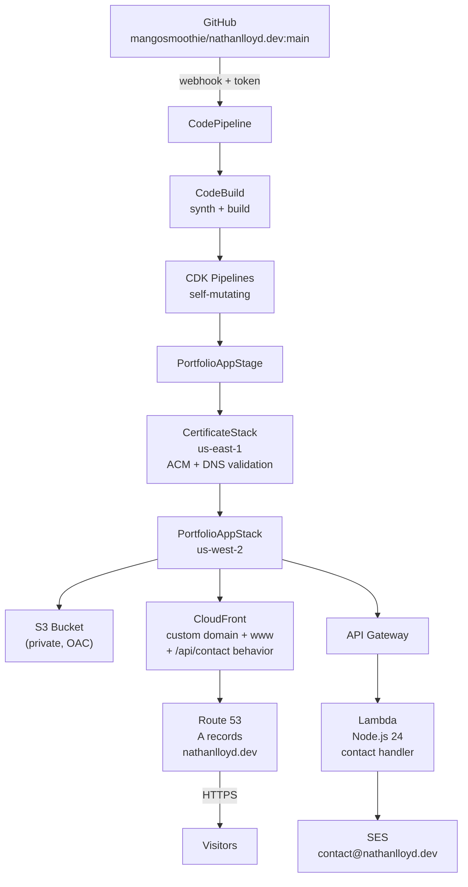

# nathanlloyd.dev

Personal portfolio and contact site for Nathan Lloyd, Full Stack Cloud & AI Developer based in Windsor, Colorado.

**Live site:** [https://nathanlloyd.dev](https://nathanlloyd.dev)

## Purpose

Professional online presence showcasing 20+ years of enterprise results delivering secure, scalable AI and cloud solutions at AMD, IRS, General Motors, and Blue Cross Blue Shield NC. Includes a fully functional serverless contact form.

This project demonstrates production-grade serverless architecture, infrastructure as code, and automated CI/CD on AWS.

## Architecture



## Key Technical Features

- **Static site hosting** — Vite-built single-page site deployed to S3 with CloudFront Origin Access Control (no public bucket access)
- **Custom domain + TLS** — `nathanlloyd.dev` and `www.nathanlloyd.dev` via ACM certificate (DNS-validated in us-east-1) + Route 53 alias records
- **Serverless contact form** — `POST /api/contact` routed through CloudFront → API Gateway → Lambda → SES
  - Domain-verified SES identities (`contact@` and `no-reply@`)
  - Honeypot + client-side rate limiting (60s)
  - CORS strictly limited to production origin
- **Self-updating CI/CD pipeline** — AWS CodePipeline + CodeBuild driven by CDK Pipelines construct
  - Automatically triggered on push to `main`
  - Builds website, synthesizes CDK, deploys infrastructure
  - Cross-region references supported
- **GitHub integration** — `CodePipelineSource.gitHub()` authenticated via `github-token` stored in AWS Secrets Manager (never committed)
- **Pure TypeScript CDK v2** — Multi-stack, multi-stage design with clear separation (`stacks/`, `stages/`, `lambda/`)
- **Modern minimal frontend** — Vanilla HTML + Tailwind (via Vite plugin), class-based dark mode, no heavy JS framework
- **Security & least privilege** — Private S3, OAC, scoped IAM policies, short log retention, no long-lived credentials in repo

## Project Structure

```
.
├── website/                 # Frontend (Vite + Tailwind v4)
│   ├── index.html
│   ├── src/styles.css
│   ├── public/
│   └── vite.config.ts
├── cdk/                     # Infrastructure as Code
│   ├── src/
│   │   ├── config.ts
│   │   ├── stacks/
│   │   │   ├── pipeline-stack.ts
│   │   │   └── portfolio-app-stack.ts
│   │   ├── stages/
│   │   │   └── portfolio-app-stage.ts
│   │   └── lambda/contact.ts
│   └── bin/cdk.ts
├── package.json             # Root scripts for CI
├── .env                     # CDK account/region (gitignored)
└── AGENTS.md
```

## Local Development

```bash
npm install
cd website && npm run dev     # Vite dev server
```

CDK operations:

```bash
npm run cdk -- synth
npm run cdk -- deploy ...
```

## CI/CD & Deployment

Every push to `main` triggers the pipeline:

1. `npm run install:ci` — installs for root + cdk + website
2. `npm run build:ci` — TypeScript build + Vite production build
3. `npm run synth:ci` — CDK synth
4. CDK Pipelines deploys (or updates) the pipeline itself + application stage

Initial bootstrap (one time):

```bash
cd cdk && npx cdk bootstrap
npm run cdk -- deploy PortfolioPipelineStack --require-approval never
```

## Tech Stack

- **Frontend**: Vite, Tailwind CSS, vanilla JS
- **Backend**: AWS Lambda (Node.js 24), API Gateway, SES (Sending emails from an SES-verified domain, nathanlloyd.dev)
- **Infrastructure**: AWS CDK v2 (TypeScript), CodePipeline, CodeBuild, CloudFront, S3, Route 53, ACM
- **Tooling**: TypeScript, ESLint, Prettier, Vitest
- **CI/CD**: Fully serverless via CDK Pipelines

## Why This Architecture?

This project is intentionally built as a real, production serverless system rather than a static site generator. It showcases:

- End-to-end serverless delivery (no servers, no containers)
- Secure custom domain + email without third-party form services
- Professional CI/CD with self-mutating pipelines
- Cross-region certificate handling
- Clean separation of concerns and least-privilege security

All of which are directly relevant to enterprise cloud and AI engineering work.

---

© 2026 Nathan Lloyd
